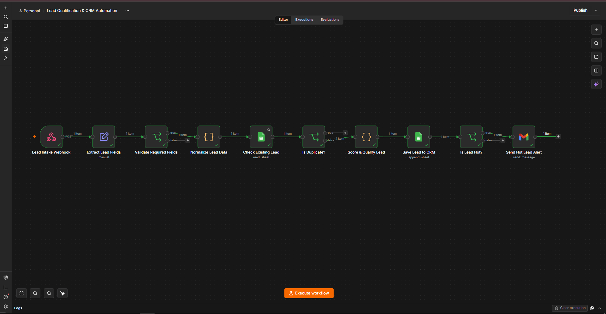
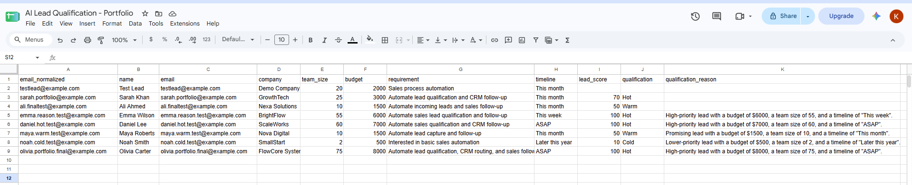
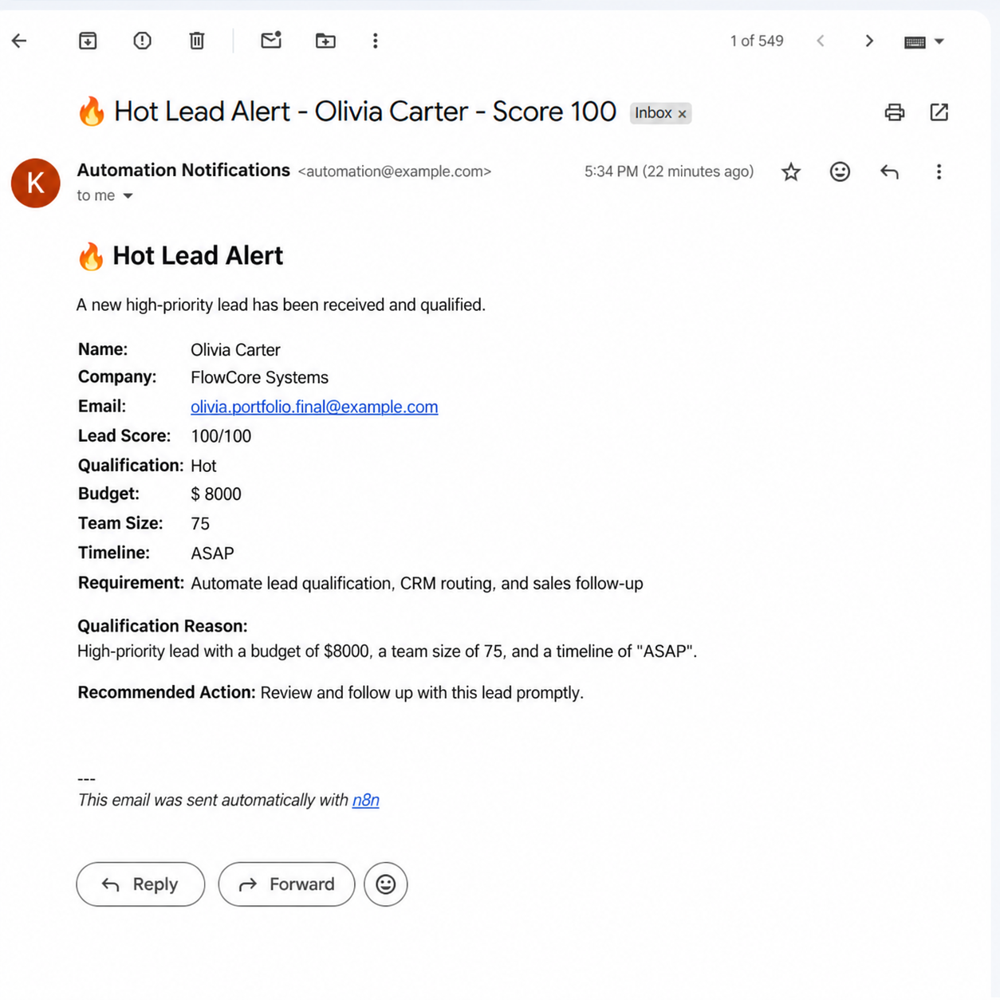

# Lead Qualification & CRM Automation

An end-to-end lead intake and qualification workflow built with **n8n**, **Google Sheets**, **JavaScript**, and **Gmail**.

The automation receives leads through a webhook, validates and normalizes incoming data, prevents duplicate records, calculates a deterministic lead score, classifies leads as Hot, Warm, or Cold, stores qualified lead data in Google Sheets, and automatically sends an email notification when a Hot lead is detected.

## Workflow Overview



### Automation Flow

Webhook Intake  
→ Extract Lead Fields  
→ Validate Required Fields  
→ Normalize Lead Data  
→ Check Existing Lead  
→ Duplicate Detection  
→ Score & Qualify Lead  
→ Save Lead to CRM  
→ Hot Lead Check  
→ Gmail Alert

## Business Problem

Sales teams often receive leads from multiple sources and manually review each submission before deciding which prospects deserve immediate attention.

This creates several problems:

- duplicate leads can enter the CRM
- incomplete submissions waste sales time
- qualification can be inconsistent
- high-value prospects may not receive timely follow-up
- manual data entry increases operational workload

This workflow automates that process and provides a consistent qualification pipeline.

## Solution

The workflow accepts structured lead information through an HTTP POST webhook.

Each submission contains:

- Name
- Email
- Company
- Team size
- Budget
- Requirement
- Timeline

The automation then validates the submission, normalizes the email address, checks Google Sheets for an existing lead, scores new leads according to defined business rules, stores the result, and sends an email alert when a lead meets the Hot qualification threshold.

## Lead Validation

The workflow requires both:

- `name`
- `email`

If either field is missing, the lead follows the validation failure branch and does not continue into the qualification pipeline.

This prevents incomplete records from entering the CRM dataset.

## Email Normalization

Before duplicate detection, email addresses are normalized using JavaScript:

- leading/trailing whitespace is removed
- characters are converted to lowercase

Example:

`Example.User@Email.com` → `example.user@email.com`

This creates a consistent identifier for duplicate checking.

## Duplicate Prevention

The normalized email address is searched against the `email_normalized` column in Google Sheets.

If a matching record exists, the lead is treated as a duplicate and the qualification/storage path stops.

Only new leads continue to scoring.

## Lead Scoring Model

Qualification uses transparent, deterministic business rules rather than an LLM.

The maximum score is **100 points**.

### Budget — Maximum 40 Points

| Budget | Points |
|---|---:|
| $5,000+ | 40 |
| $2,000–$4,999 | 30 |
| $1,000–$1,999 | 20 |
| $1–$999 | 10 |
| No budget | 0 |

### Team Size — Maximum 30 Points

| Team Size | Points |
|---|---:|
| 50+ | 30 |
| 20–49 | 20 |
| 5–19 | 10 |
| Under 5 | 0 |

### Timeline — Maximum 30 Points

| Timeline | Points |
|---|---:|
| This week / Immediately / ASAP | 30 |
| This month | 20 |
| Quarter / 3 months | 10 |
| Other | 0 |

## Qualification Levels

The final score determines the lead category:

| Score | Qualification |
|---|---|
| 70–100 | 🔥 Hot |
| 40–69 | Warm |
| 0–39 | Cold |

The workflow also generates a human-readable qualification reason containing the lead's budget, team size, and timeline.

## CRM Storage

New leads are appended to Google Sheets with the following fields:

- `email_normalized`
- `name`
- `email`
- `company`
- `team_size`
- `budget`
- `requirement`
- `timeline`
- `lead_score`
- `qualification`
- `qualification_reason`

Google Sheets is used as a lightweight CRM/data store for this portfolio implementation.

## Qualification Results



The workflow was tested with different lead profiles to verify Hot, Warm, and Cold qualification behavior.

## Hot Lead Notification

After a lead is stored, the workflow checks whether:

`qualification = Hot`

Only Hot leads continue to the Gmail notification node.

The email contains:

- Lead name
- Company
- Email
- Lead score
- Qualification
- Budget
- Team size
- Timeline
- Requirement
- Qualification reason
- Recommended action



Warm and Cold leads remain recorded in Google Sheets but do not trigger the Hot Lead email alert.

## Tested Scenarios

The workflow was manually tested across the main execution paths.

| Test | Expected Result | Status |
|---|---|---|
| Valid new lead | Process and store lead | ✅ Passed |
| Existing email | Detect duplicate and stop new-lead path | ✅ Passed |
| Hot lead | Store + send Gmail alert | ✅ Passed |
| Warm lead | Store without Hot alert | ✅ Passed |
| Cold lead | Store without Hot alert | ✅ Passed |
| Missing email | Reject during validation | ✅ Passed |
| Post-refactor Hot lead | Complete end-to-end execution | ✅ Passed |

A final Hot-lead test produced a score of **100/100**, stored the lead successfully, and generated the expected Gmail notification.

## Tech Stack

- **n8n** — workflow orchestration
- **JavaScript** — normalization and scoring logic
- **Google Sheets** — duplicate lookup and lightweight CRM storage
- **Gmail** — Hot lead notifications
- **HTTP Webhook** — lead intake
- **PowerShell** — webhook testing during development

## Project Structure

```text
ai-lead-qualification-crm-automation/
├── README.md
├── workflow/
│   └── ai-lead-qualification-crm-automation.json
├── screenshots/
│   ├── workflow-overview.png
│   ├── google-sheets-results.png
│   └── hot-lead-email-alert.png
└── docs/
    └── test-scenarios.md
```

## Import & Setup

### 1. Import the workflow

Import:

`workflow/ai-lead-qualification-crm-automation.json`

into your n8n instance.

### 2. Configure Google Sheets

Create a Google Sheet containing these headers:

```text
email_normalized
name
email
company
team_size
budget
requirement
timeline
lead_score
qualification
qualification_reason
```

Configure your own Google Sheets credentials in n8n and update the Google Sheets nodes to point to your document and sheet.

### 3. Configure Gmail

Connect your Gmail credential to the `Send Hot Lead Alert` node.

Replace the placeholder notification recipient with your desired email address.

### 4. Configure the Webhook

Use the `Lead Intake Webhook` endpoint to submit lead data using an HTTP POST request.

Example payload:

```json
{
  "name": "Example Lead",
  "email": "lead@example.com",
  "company": "Example Company",
  "team_size": 50,
  "budget": 5000,
  "requirement": "Automate lead qualification and CRM follow-up",
  "timeline": "ASAP"
}
```

### 5. Test the workflow

Submit a unique email address and verify that the lead:

1. passes validation
2. is normalized
3. passes duplicate detection
4. receives a score
5. is stored in Google Sheets
6. triggers an email alert when classified as Hot

## Security & Portfolio Version

The workflow JSON included in this repository is a **sanitized portfolio version**.

Personal email addresses, Google Sheet identifiers, credential references, webhook-specific identifiers, and local n8n instance metadata have been removed or replaced with placeholders.

No authentication secrets or OAuth tokens are included.

## Design Decisions

### Why deterministic scoring instead of an AI Agent?

The qualification criteria in this workflow are explicit business rules based on budget, team size, and timeline.

Using deterministic logic provides:

- predictable scoring
- explainable decisions
- consistent results
- lower operational cost
- easier testing and debugging

An LLM or AI Agent would be more appropriate if qualification required interpreting complex unstructured conversations, researching companies, choosing tools dynamically, or making multi-step autonomous decisions.

This project therefore uses rule-based qualification intentionally rather than adding AI where deterministic automation is sufficient.

## Possible Future Improvements

Potential extensions include:

- LLM-based analysis of free-text lead requirements
- CRM integration with platforms such as HubSpot or Pipedrive
- configurable scoring rules
- automated sales follow-up sequences
- lead assignment and routing
- error handling and execution monitoring
- analytics/dashboard reporting

## What This Project Demonstrates

This project demonstrates practical workflow automation skills including:

- webhook/API intake
- structured data transformation
- input validation
- JavaScript processing
- data normalization
- duplicate detection
- conditional branching
- deterministic business-rule implementation
- Google Sheets integration
- automated email notifications
- end-to-end workflow testing
- credential-safe workflow sharing

---

Built as a practical AI automation portfolio project using n8n.
```


